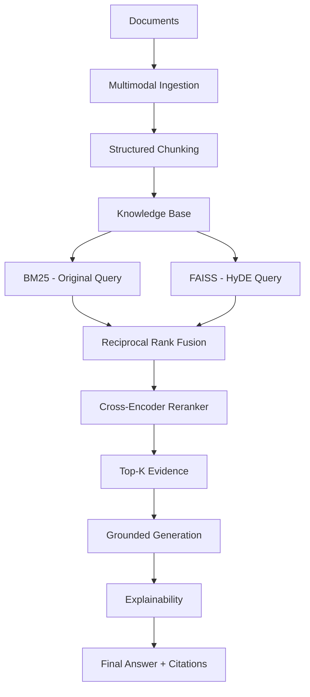

# AI-Powered Multimodal Study Assistant

A local-first, research-oriented RAG system that lets students upload their own
study material — PDFs, slides, documents, images, diagrams, and lecture
transcripts/audio — and get grounded, cited answers, summaries, and generated
study material (quizzes, MCQs, flashcards).

This is a **fresh implementation**, not a fork. It reproduces a published RAG
baseline architecture (see [Research Foundation](#5-research-foundation)) and
then evaluates our own extensions on top of it. See
[docs/decisions/ADR-001-fresh-implementation.md](docs/decisions/ADR-001-fresh-implementation.md).

## Table of Contents

1. [Overview](#1-overview)
2. [Problem Statement](#2-problem-statement)
3. [Objectives](#3-objectives)
4. [Core Features](#4-core-features)
5. [Research Foundation](#5-research-foundation)
6. [Baseline Architecture](#6-baseline-architecture)
7. [Proposed Extensions](#7-proposed-extensions)
8. [Technology Stack](#8-technology-stack)
9. [Repository Structure](#9-repository-structure)
10. [Development Setup](#10-development-setup)
11. [Running Locally](#11-running-locally)
12. [Testing](#12-testing)
13. [Evaluation](#13-evaluation)
14. [Research / Reproducibility](#14-research--reproducibility)
15. [Roadmap](#15-roadmap)
16. [License](#16-license)

## 1. Overview

Students accumulate study material across many formats and struggle to get
reliable, traceable answers from it. This project builds a retrieval-augmented
assistant that answers questions **grounded in the student's own uploaded
material**, with explicit citations, and that says so when it doesn't have
enough evidence rather than guessing.

## 2. Problem Statement

General-purpose LLM chat is not reliably grounded in a student's specific
course material, does not cite sources, cannot easily handle mixed modalities
(text, images, diagrams, audio), and tends to answer confidently even when it
lacks sufficient evidence. This project addresses those gaps for a bounded,
single-user, local-first study-assistant use case.

## 3. Objectives

- Ingest multimodal educational documents into a searchable knowledge base.
- Answer questions with retrieval-grounded, cited responses.
- Detect when evidence is insufficient and abstain rather than hallucinate.
- Generate study aids (summaries, quizzes, MCQs, flashcards, comparisons).
- Keep the system modular and swappable so components can be evaluated and
  replaced independently, and keep every experiment reproducible.

## 4. Core Features

Planned end-state feature set (built incrementally by phase, see
[Roadmap](#15-roadmap)):

- Conversational Q&A grounded in uploaded material, with citations
- Document summarization, explanation, and comparison
- Quiz / MCQ / flashcard generation from source material
- Multimodal understanding (text, images, diagrams, transcripts, audio)
- Evidence attribution and token-level grounding
- Contradiction detection across sources
- Evidence sufficiency checking and explicit abstention

**Status:** none of the above are implemented yet. Phase 1 (document
ingestion — upload, parsing, structure-aware chunking) and Phase 2
(baseline retrieval — BM25, dense/FAISS, RRF, HyDE, cross-encoder
reranking; see [docs/architecture/retrieval.md](docs/architecture/retrieval.md))
are complete; the conversational/generation features above depend on
generation (Phase 3), which has not started — see [Roadmap](#15-roadmap).

## 5. Research Foundation

The baseline architecture and component choices in this project are based on
the **EduRAG** research paper's design: a hybrid BM25 + FAISS retrieval
pipeline with HyDE query expansion, Reciprocal Rank Fusion, cross-encoder
reranking, grounded generation, and explainability (citation validation,
token grounding).

**We are not claiming to have invented RAG, hybrid retrieval, BM25, FAISS,
HyDE, RRF, reranking, or explainability techniques.** EduRAG is our baseline
and research foundation; this repository is our own implementation of that
architecture, plus our own proposed extensions and evaluation.

## 6. Baseline Architecture



Baseline components:

| Stage | Component |
|---|---|
| Document parsing | Docling |
| Chunking | Structure-aware, ~512-token baseline |
| Duplicate filtering | Perceptual hashing (images) |
| Visual processing | VLM description + OCR, original image retained |
| Embeddings | BAAI/bge-small-en-v1.5 |
| Dense retrieval | FAISS |
| Lexical retrieval | BM25 |
| Query expansion | HyDE (DeepSeek-R1 1.5B or equivalent local model) |
| Fusion | Reciprocal Rank Fusion (k=60 baseline) |
| Reranking | cross-encoder/ms-marco-MiniLM-L-6-v2 |
| Generation | DeepSeek-R1 8B via Ollama (replaceable) |
| Explainability | Chunk attribution, citation validation, token grounding |

Full detail: [docs/architecture/system-architecture.md](docs/architecture/system-architecture.md).

## 7. Proposed Extensions

Implemented **after** the baseline is working and evaluated, one at a time:

- Structure-aware hierarchical / parent-child retrieval
- Evidence sufficiency detection and explicit abstention
- Contradiction / conflicting-evidence detection
- Original visual evidence preservation (image + OCR + VLM description + page/slide metadata, not just captions)
- Equation-aware document processing where practical
- Page / section / slide / timestamp citations
- Query intent classification
- Study-generation engine (summaries, quizzes, MCQs, flashcards, comparison)
- Retrieval and generation observability
- Ablation experiments quantifying each extension's contribution

**None of these are implemented yet.** No experimental results are claimed
until experiments are actually run — see [Evaluation](#13-evaluation).

## 8. Technology Stack

| Layer | Choice |
|---|---|
| Backend | Python 3.12, FastAPI |
| Frontend | React, TypeScript, Vite, Tailwind CSS |
| Document processing | Docling |
| Embeddings | BAAI/bge-small-en-v1.5 |
| Dense retrieval | FAISS (`IndexFlatIP`) |
| Lexical retrieval | BM25 (`rank-bm25`) |
| Reranking | cross-encoder/ms-marco-MiniLM-L-6-v2 |
| LLM (HyDE only, Phase 2) | Ollama-compatible local model, `deepseek-r1:1.5b` preferred |
| LLM (generation, Phase 3) | Ollama-compatible local model *(planned)* |
| Vision | LLaVA-Phi3 or replaceable VLM *(planned)* |
| Audio | Whisper *(planned, when audio is implemented)* |
| Database | SQLite |
| Backend tooling | uv, pytest, Ruff, mypy |
| Frontend tooling | pnpm, oxlint |

Nothing marked "planned" is implemented yet. This is a local-first
project deliberately without Kubernetes, microservices, Redis, Kafka,
PostgreSQL, or cloud infrastructure — see
[docs/decisions/ADR-002-local-first.md](docs/decisions/ADR-002-local-first.md).

## 9. Repository Structure

```
.
├── backend/          FastAPI application (app/, tests/, pyproject.toml)
├── frontend/         React + TypeScript + Tailwind app (src/, public/)
├── evaluation/       Datasets, benchmarks, metrics, experiments
├── docs/             Architecture, research, decisions (ADRs), API docs
├── scripts/          Utility scripts
├── tests/            Repo-level / cross-cutting tests (currently empty)
├── data/             raw/ and processed/ — never committed, .gitkeep only
├── models/           Local model weights — never committed, .gitkeep only
├── .env.example
└── .gitignore
```

## 10. Development Setup

**Backend** (Python 3.12, managed with [uv](https://docs.astral.sh/uv/)):

```bash
cd backend
uv sync --dev
```

**Frontend** (Node 22+, managed with pnpm — pnpm 11 requires Node ≥22.13):

```bash
cd frontend
pnpm install
```

**Environment variables**: copy `.env.example` to `.env` and adjust as
needed. Never commit `.env`.

```bash
cp .env.example .env
```

## 11. Running Locally

**Backend API**:

```bash
cd backend
uv run uvicorn app.main:app --reload
```

Then check `GET http://127.0.0.1:8000/health` → `{"status": "ok"}`.

**Frontend**:

```bash
cd frontend
pnpm dev
```

Then open `http://localhost:5173` and upload a PDF/DOCX/PPTX/HTML file —
ingestion status and chunk count appear once processing completes. Run
both servers together to try this; the frontend calls the backend at
`http://localhost:8000` by default (override with `VITE_API_BASE_URL`),
and the backend allows that origin via `CORS_ALLOWED_ORIGINS`.

## 12. Testing

**Backend**:

```bash
cd backend
uv run pytest
uv run ruff check .
uv run mypy app
```

**Frontend**:

```bash
cd frontend
pnpm run build   # tsc -b && vite build
pnpm run lint
```

## 13. Evaluation

Evaluation datasets, metrics, and ablation design live in
[evaluation/](evaluation/) and [docs/research/](docs/research/). See:

- [docs/research/evaluation-plan.md](docs/research/evaluation-plan.md)
- [docs/research/ablation-plan.md](docs/research/ablation-plan.md)

No benchmark numbers are reported anywhere in this repository until the
corresponding experiments have actually been run. The system does not claim
to be hallucination-free or to achieve perfect accuracy.

## 14. Research / Reproducibility

Every experiment must record its exact configuration (model names/versions,
chunk size, retrieval top-K, RRF parameters, reranker, generation parameters,
seeds). See [docs/research/reproducibility.md](docs/research/reproducibility.md).

## 15. Roadmap

See [docs/roadmap.md](docs/roadmap.md) for the full phase-by-phase plan.
Current status: **Phase 1 — Document Ingestion** complete. See
[docs/architecture/ingestion.md](docs/architecture/ingestion.md) for what
was built.

## 16. License

See [LICENSE](LICENSE).
