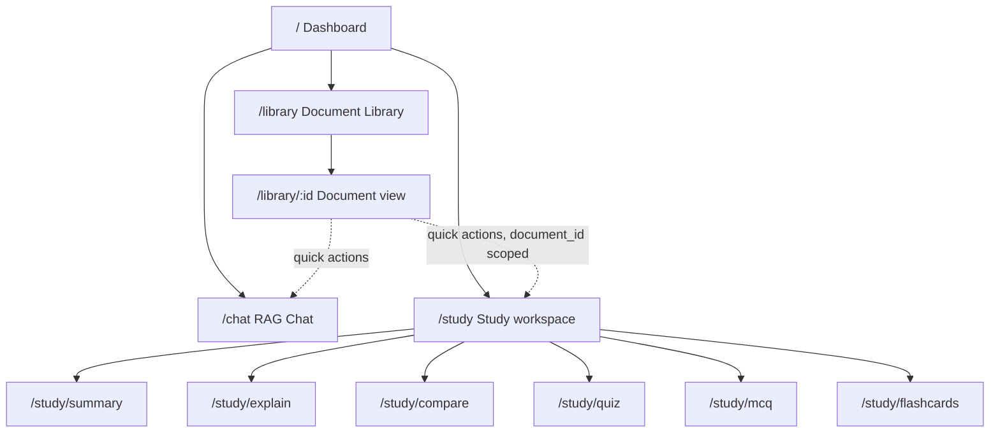

# Application / UI (Phase 6)

Turns the existing Phase 0-5 backend (ingestion, retrieval, grounded
generation + explainability, multimodal processing, study engine) into a
complete, student-facing web application. Frontend only, except for two
minimal additive backend endpoints the UI could not function without (see
"Backend additions" below) — no retrieval/generation/grounding/citation/
study-engine algorithm is modified.

## Scope boundary

**Our implementation**: a React 19 + TypeScript + Vite + Tailwind CSS v4
single-page application, extending the Phase 0 minimal shell rather than
replacing it (`AppShell`, the design tokens in `src/styles/index.css`, and
the overall component/page split were kept and built out).

**Proposed future extensions** (out of scope here): authentication,
multi-user support, deployment/hosting, learner analytics, spaced
repetition, gamification, offline support, streaming token-by-token
answers.

## Stack

React 19, TypeScript, Vite 8, Tailwind CSS v4, `react-router-dom` (client-
side routing — the only new runtime dependency; nothing else was added).
State stays local: `useState`/`useEffect` and small custom hooks
(`useDocuments`), no Redux/Zustand — the app's state (a document list, one
in-flight request's result) never needed more than component-local state
plus one shared hook.

## Information architecture

## API integration

`frontend/src/lib/api/` is the single typed API layer (spec section 18) —
no component calls `fetch` directly.

- `client.ts` — base URL (`VITE_API_BASE_URL`, default
  `http://localhost:8000`), JSON/multipart requests, `ApiError`, no auth
  headers (the backend has no auth — see
  [ADR-002](../decisions/ADR-002-local-first.md)).
- `documents.ts`, `chunks.ts`, `chat.ts`, `study.ts` — one thin function
  per backend endpoint.
- `types.ts` — TypeScript interfaces mirroring `backend/app/schemas/*.py`
  by hand (not code-generated — the schema set is small and stable enough
  that a generator would be net overhead here).

Every request/response shape was read from the actual Pydantic schemas
and `docs/API.md` before being typed — no endpoint or field was assumed.

## Evidence / citation UI

The central requirement (spec section 8/9): every answer that has
evidence shows exactly what grounded it. `components/evidence/` holds one
shared implementation used by chat and all six study modes:

- `SourceCard` — normalizes a chat/study `EvidenceItem` or `Citation` into
  one `NormalizedSource` shape and renders filename, page/section,
  audio timestamp range, modality badge, and (validated citations only)
  a valid/invalid status badge. Expandable per source for image/diagram
  (via `ArtifactImage`), OCR text, VLM description, or table content —
  never fabricated: a source with no such field renders no such section.
- `ArtifactImage` — evidence items only carry `chunk_id`, not
  `artifact_id`, so this resolves one through `GET /chunks/{id}`
  (Phase 4's existing debug endpoint, which already returns
  `artifact_id`) before requesting the file.
- `CitationPanel` / `EvidenceConsideredPanel` — the former renders an
  answer's validated citations ("Sources"); the latter, collapsed by
  default, renders the full retrieved evidence context.
- `InsufficientEvidenceState` — rendered instead of an answer whenever
  `answerable: false`, using the backend's own `sufficiency.reason`/
  `reason` field, never a generic fallback that could misrepresent why.

## Study modes

`pages/study/*Tab.tsx`, one per mode, sharing:

- `GenerativePanel` — Summary and Explain have an identical response
  shape (`SummaryResponse`/`ExplainResponse` are the same type on the
  backend), so one component covers both, parameterized by the one field
  that differs (`length` vs `style`).
- `GenerationControls` — the count/difficulty/topic/scope form shared by
  Quiz, MCQ, and Flashcards.
- `QuizRunner`, `MCQRunner`, `FlashcardDeck` — mode-specific interaction
  (reveal-answer, single-select with correct/incorrect feedback and a
  running score, flip-card navigation). None of them determine
  correctness or generate content client-side — every question, option,
  answer, and score comes from the backend response.
- `DocumentScopeSelect` — every study request's optional `document_id`
  scope, backed by the real document list (`useDocuments`), never a
  free-text field.

Chat is **not** document-scoped: `POST /chat/query` has no `document_id`
parameter (only the six study endpoints do), so the UI does not offer a
chat document filter — adding one would be an unsupported parameter (spec
section 11/18 both rule this out).

## Backend additions

Two minimal, additive endpoints were added because the UI could not
function correctly without them (spec section 24) — see
[docs/API.md](../API.md) for full request/response detail:

1. **`DELETE /documents/{id}`** — the document library needs a delete
   action (spec section 5); no such endpoint existed. Removes the
   document row plus dependent `chunks`/`artifacts`/`study_items` rows
   (foreign keys aren't `ON DELETE CASCADE`) and the document's files
   under `data/raw`/`data/processed`.
2. **`GET /artifacts/{id}/file`** — the multimodal evidence UI needs to
   display images/diagrams (spec section 9); no endpoint served artifact
   bytes before. Resolves the stored `storage_path` back through
   `DataPaths.resolve_stored_path`, which rejects any path escaping the
   data root — the same discipline every other file path on this API
   already follows.

Both are covered by backend tests (`backend/tests/ingestion/
test_api_documents.py`, `backend/tests/multimodal/
test_api_documents_multimodal.py`) and pass the existing ruff/mypy gates.

Separately, `feature/study-engine` — a fully implemented Phase 5 backend,
including its API — had never been merged into `develop`. It was merged
during this phase (a clean merge; it branched off `develop`'s tip) since
the Study workspace UI needed it; see the PR history on `develop` for
detail.

## States

Every page follows the same discipline: a loading state during a request
(`LoadingState`), a retryable error state on failure (`ErrorState`, always
showing the backend's own error message, never a generic string when one
is available), and an empty state where there is no data yet
(`EmptyState`) — never a blank screen. `InsufficientEvidenceState` is a
fourth, generation-specific state distinct from a network error.

## Accessibility

Semantic HTML throughout (`<nav>`, `<fieldset>`/`<legend>` for the MCQ
question group, `role="radiogroup"`/`role="radio"` for MCQ options,
`<label htmlFor>` on every input), a skip-to-content link, visible
`focus-visible` outlines on every interactive element, `role="alert"` on
error states and `role="status"` on loading states for screen readers,
and no interaction that depends solely on hover (drag-and-drop upload has
a click fallback; expandable evidence sections are buttons).

## Testing

`frontend/src/**/*.test.tsx` (Vitest + Testing Library + jsdom), covering:
the app renders (`App.test.tsx`), the document list renders/uploads/
handles API errors (`LibraryPage.test.tsx`), a chat request renders an
answer with citations, an insufficient-evidence state, and an API error
(`ChatPage.test.tsx`), study-mode tab navigation (`StudyPage.test.tsx`),
MCQ answer selection and scoring (`MCQRunner.test.tsx`), and flashcard
flip/navigation (`FlashcardDeck.test.tsx`). Network calls are stubbed at
the `fetch` layer (`src/test/mockFetch.ts`) rather than mocking the API
module, so the real `lib/api/client.ts` request/error-handling code path
is exercised.

## Known limitations

- No conversation memory: `POST /chat/query` is stateless per the backend
  (see [docs/architecture/generation.md](generation.md)), so the chat UI
  keeps only in-session message history — no server-persisted threads.
- No document-scoped chat (see "Study modes" above) — a backend
  limitation, not a UI gap.
- Dashboard "recent study activity" is not implemented: the backend
  persists `study_items` but exposes no list/history endpoint, so nothing
  is fabricated here — only document count/recency is shown.
- No pagination on the document list or evidence lists — acceptable at
  the scale a single student's local corpus reaches; would need revisiting
  before this became a shared/hosted product.
- `EvidenceItemResponse`/`CitationResponse` (chat and study) don't carry
  an `equation_content` field (only the Phase 4 `GET /chunks/{id}` debug
  endpoint does), so equation evidence falls back to the generic
  `content_preview` text rather than a dedicated equation display — the
  UI doesn't add a field the API doesn't expose. Matches the backend's
  own documented equation-representation limitation (see
  [docs/architecture/multimodal.md](multimodal.md)).
