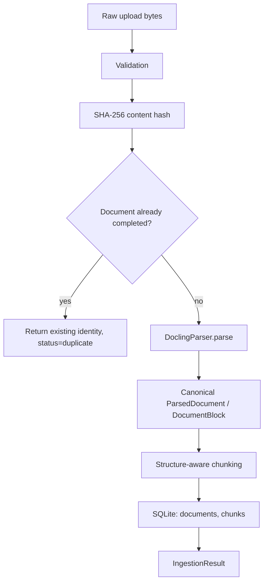

# Ingestion Architecture (Phase 1)

Status: **implemented**. This document describes the ingestion pipeline as
it actually exists in `backend/app/ingestion/`, not a plan — see
[docs/roadmap.md](../roadmap.md) for what is still ahead.

## Pipeline



Implemented in `app/ingestion/service.py::IngestionService.ingest`, composed
from the independently-testable modules below rather than one large
function (see PHASE 1 §15 of the project brief).

## 1. Supported Formats

PDF, DOCX, PPTX, HTML/HTM — `Settings.supported_extensions_raw`
(comma-separated, parsed into a tuple at the API layer). Audio/Whisper and
VLM image understanding are explicitly out of scope for Phase 1 (Phase 5+).

Adding a format means adding another `DocumentParser` implementation
(`app/ingestion/parsers/base.py`) — nothing outside `app/ingestion/parsers/`
needs to change, per
[ADR-004](../decisions/ADR-004-model-agnostic-interfaces.md).

## 2. Validation

`app/ingestion/validation.py::validate_upload` — runs before any parsing:

- filename present, extension in the supported set
- non-empty
- under `Settings.max_upload_size_mb` (implementation choice: 50MB, not a
  value the baseline paper specifies)
- filename sanitized (`app/ingestion/storage.py::sanitize_filename` — takes
  the OS path basename, strips anything outside `[A-Za-z0-9._-]`)

Validation never reads file content for anything beyond size/emptiness —
it does not sniff or execute the upload.

## 3. Hashing and Document Identity

`app/ingestion/hashing.py` computes SHA-256 over the raw bytes.

**Implementation choice**: `document_id = file_hash` (the full hex digest).
This is not specified by EduRAG — it is our own design decision, and it is
what makes duplicate detection a primary-key lookup rather than a separate
query: re-uploading identical bytes always produces the same document id,
so `IngestionService.ingest` can check `DocumentRepository.get_by_id`
before doing any parsing work. If a document with that id already has
`status="completed"`, ingestion short-circuits and returns
`status="duplicate"` with the previously computed counts — it does not
re-parse or re-chunk. A document that previously failed (`status="failed"`
or a stale `"processing"` row from an interrupted run) is retried rather
than treated as a duplicate.

Filenames are never used for document identity — two different filenames
with identical content are the same document; the same filename uploaded
twice with different content is not.

## 4. Parsing: Docling

`app/ingestion/parsers/docling_parser.py::DoclingParser` is the **only**
place in the application that imports `docling`/`docling_core` directly
(ADR-004). It wraps `docling.document_converter.DocumentConverter` and
walks `DoclingDocument.iterate_items()`, mapping Docling's `DocItemLabel`
onto our own `BlockType` enum:

| Docling label | `BlockType` |
|---|---|
| `title`, `section_header` | `HEADING` |
| `text`, `paragraph` | `PARAGRAPH` |
| `list_item` | `LIST` |
| `table` | `TABLE` |
| `picture` | `IMAGE` |
| `formula` | `EQUATION` |
| `code` | `CODE` |
| `caption` | `CAPTION` |
| anything else | `UNKNOWN` |

Heading hierarchy (`heading_path`, `section`) is reconstructed from
Docling's item nesting depth (the `level` value `iterate_items()` yields):
a stack of `(level, heading_text)` is popped whenever a new heading arrives
at a level ≤ the top of the stack, then pushed. This is an **implementation
choice** — a heuristic over Docling's tree, not a general algorithm — that
works correctly for sequentially-nested documents (chapter → section →
paragraph) but is not proven against arbitrarily malformed structure.

Docling can place some items (observed: DOCX images) on a content layer
`iterate_items()` does not traverse. `DoclingParser` recovers these by also
checking `doc.pictures` / `doc.tables` directly and appending anything not
already captured (deduplicated by Docling's `self_ref`), so nothing is
silently dropped.

### Known limitations (documented, not worked around)

- **PDF fidelity on small documents**: Docling's default PDF pipeline uses
  ML layout detection + RapidOCR. On the tiny synthetic PDF fixture used in
  tests, it reliably detects headings/paragraphs/page numbers but does
  **not** reliably detect the list/table/image also present in the same
  content — DOCX/PPTX/HTML use format-native (non-ML) backends and detect
  all of these reliably. This is a property of Docling itself; we do not
  add fallback logic to compensate for it in Phase 1. Table/image
  preservation is therefore verified against DOCX/PPTX/HTML fixtures.
- **HTML image bytes**: Docling's HTML backend recognizes an `` tag
  structurally (an `IMAGE` block is produced) but does not decode the
  image bytes the way its DOCX/PPTX backends do — `image_path` stays
  `None` for HTML-sourced images. DOCX/PPTX/PDF-with-embedded-images do
  get their bytes extracted and saved.
- **Equations**: the `EQUATION` block type, `equation_content` field, and
  the `formula → EQUATION` label mapping exist end-to-end and are covered
  by unit tests, but Docling's formula detection requires its optional
  `do_formula_enrichment` pipeline option, which downloads an additional
  VLM model. That option is **not enabled** in Phase 1 — the same
  reasoning as not doing VLM image understanding yet: keep local-first
  ingestion lightweight. A document containing an equation will currently
  have that content classified as plain text rather than `EQUATION`.
- **Native metadata**: DOCX/PPTX core properties (author/subject/created/
  modified) are read directly from the source file with `python-docx` /
  `python-pptx` (already Docling dependencies), because Docling's
  canonical document does not surface them. PDF/HTML have no equivalent
  standard property Docling exposes, so these fields are `None` for those
  formats rather than guessed.

## 5. Canonical Model

`app/ingestion/models.py` — independent of Docling's classes (ADR-004):

- `DocumentMetadata`: title, author, subject, created/modified, page_count,
  source_filename, file_hash
- `DocumentBlock`: id, type (`BlockType`), content, order, page, section,
  heading_path, parent_block_id, plus multimodal payload fields
  (`image_path`, `table_content`, `equation_content`) populated only when
  the block's type matches
- `ParsedDocument`: id, filename, file_hash, file_type, metadata, blocks

Block IDs: `f"{document_id}::block::{order:05d}"` — deterministic given the
same parse order, traces back to the document via the id prefix.

## 6. Chunking

`app/ingestion/chunking.py::chunk_document`. EduRAG baseline: **~512
tokens per chunk** (`Settings.chunk_target_tokens`, default 512). Chunk
**overlap is an implementation choice, not specified by the baseline
paper** — default 50 tokens (`Settings.chunk_overlap_tokens`), documented
here rather than silently invented and attributed to EduRAG.

Algorithm:

1. Blocks are grouped into contiguous runs sharing the same section
   (deepest heading). Order is preserved — two runs with the same section
   name that are not adjacent stay in separate groups, so chunks never mix
   unrelated parts of the document.
2. Each section group gets one synthetic **parent chunk**
   (`f"{document_id}::section::{order:05d}"`, `chunk_type=HEADING`,
   `parent_id=None`) representing the section itself. This is only a data
   representation for later hierarchical retrieval (README §9) — **Phase 1
   does not use `parent_id` for retrieval**, that is a Phase 2+ decision.
3. Within a section, contiguous text-bearing blocks (heading/paragraph/
   list) are packed into ~`chunk_target_tokens`-sized **child chunks**
   (`f"{document_id}::chunk::{order:05d}"`, `parent_id=<section chunk id>`),
   carrying forward the last `chunk_overlap_tokens` words of the previous
   chunk as a seed so context is not lost at a boundary.
4. Table, image, equation, caption, code, and unknown blocks are **never**
   merged into a text chunk — each becomes its own dedicated child chunk,
   so structured content is not diluted and nothing is silently dropped.

Token counting (`approx_token_count`) is a **whitespace-split
approximation**, not the tokenizer of any specific embedding model — that
alignment is deferred to Phase 2 when the embedding model is actually
wired in. This is an implementation choice.

Chunk IDs are deterministic for a given `(document_id, blocks, config)` —
they depend on document id and position, not on random values or wall-clock
time, so re-running chunking with the same input reproduces the same ids
(verified by `tests/ingestion/test_chunking.py::test_chunk_ids_are_deterministic_for_same_input`).

## 7. Image Storage

`app/ingestion/storage.py`:

```
data/
├── raw/<document_id>/<sanitized_filename>          original upload
└── processed/<document_id>/images/<block_id>.png   extracted images
```

`DataPaths` resolves every path and rejects anything that would escape the
configured `data_dir` root (`StorageError`), and `document_id`/filenames
are sanitized before being used as path components — uploaded content is
untrusted (docs/research/security.md). Images are saved as PNG regardless
of source format for a single predictable on-disk representation.

## 8. Table Handling

Docling table cells are read into a plain `list[list[str]]` grid
(`DocumentBlock.table_content` / `Chunk.table_content`) preserving row/
column structure. A simple pipe/semicolon text rendering
(`"A | B; 1 | 2"`) is also stored as the block/chunk `content` so tables
remain searchable by the baseline's lexical retrieval (Phase 2) without
requiring table-aware retrieval logic in Phase 1. No table QA or
table-specific reasoning is implemented.

## 9. Persistence

SQLite, schema defined once in `app/ingestion/schema.sql` (loaded by
`app/ingestion/repository.py::init_db`) — see
[docs/architecture/database.md](database.md) for the actual columns, which
extend the Phase 0 design doc with the status/count/error fields ingestion
needs. `DocumentRepository.upsert` is idempotent on `document_id` (keeps
the original `uploaded_at`, updates everything else) and
`ChunkRepository.replace_for_document` deletes-then-inserts so re-ingesting
a document produces a fresh, consistent chunk set rather than accumulating
stale rows.

## 10. Error Handling

`app/ingestion/errors.py`: `ValidationError`, `ParserError`, `StorageError`
(all `IngestionError`) carry a `message` safe to show a user, separate from
whatever internal exception caused them (`raise ... from exc` keeps the
original traceback in logs without exposing it in the response). The API
layer (`app/api/documents.py`) maps `ValidationError` to HTTP 400; a
failure during parsing/chunking/persistence is caught in
`IngestionService.ingest`, the document is marked `status="failed"` with
`error_message` set, and a normal `IngestionResult` is returned rather than
an unhandled exception reaching the client.

## 11. Logging

`IngestionService` logs one structured line on completion/duplicate/
failure: document id, filename, file hash, page/block/chunk/image/table
counts, and duration — never full document content or secrets (see
docs/research/security.md).

## 12. API

See [docs/API.md](../API.md) for the endpoint contracts
(`POST /documents/upload`, `GET /documents`, `GET /documents/{id}`).
