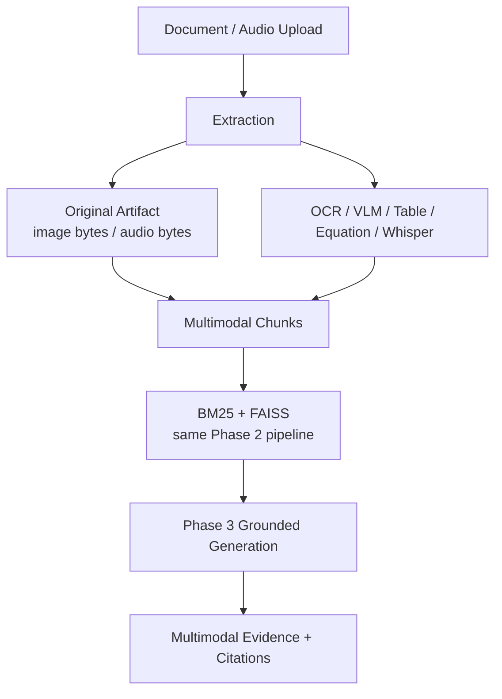

# Multimodal Processing (Phase 4)

Status: **implemented**. Extends Phase 1 ingestion, Phase 2 retrieval, and
Phase 3 generation to cover images/diagrams, tables, equations, and audio
— it does not replace or duplicate any of those pipelines (README §3's
"do not create a completely separate RAG system for images" is a hard
constraint on this phase's design, not just a suggestion).

Note on numbering: `docs/roadmap.md` labels this row "Phase 5 — Multimodal
retrieval" (the table's row 4 was struck through when Phase 3 absorbed it
— see that doc's "Phase 3 scope note"). The Phase 4 implementation brief
this work was built against calls it "Phase 4"; both names refer to the
same delivered unit. `docs/roadmap.md` is updated to reflect this
directly rather than silently diverging.

## Research Baseline

Same EduRAG baseline as retrieval/generation (README §5): "Visual
processing | VLM description + OCR, original image retained" is listed
explicitly in the README §6 baseline table. This phase implements that
row plus the project's own extensions (tables, equations, audio/Whisper,
which are not part of the EduRAG baseline table).

## Architecture



Every box above is an *extension point* on an existing pipeline stage, not
a parallel system: `Chunks` are `app.ingestion.models.Chunk` rows in the
same `chunks` table Phase 1 created; `Index` is the same
`BM25Retriever`/`DenseRetriever`/FAISS index Phase 2 built; `Gen` is the
same `GenerationService` Phase 3 built.

## Unified Chunk Representation

`app.ingestion.models.Chunk`/`DocumentBlock` are extended in place (not
replaced by a second model — spec: "Extend the existing chunk
representation"):

| Field | Added | Meaning |
|---|---|---|
| `ocr_text` | Phase 4 | OCR-extracted text from an image artifact |
| `ocr_status` | Phase 4 | `VisionStatus`: not_attempted / available / unavailable / failed |
| `vlm_description` | Phase 4 | VLM-generated description of an image/diagram |
| `vision_status` | Phase 4 | Same enum, for the VLM description specifically |
| `artifact_id` | Phase 4 | FK to the `artifacts` table (below) |
| `audio_start` / `audio_end` | Phase 4 | Seconds, for `BlockType.TRANSCRIPT` chunks |

`BlockType` gains `TRANSCRIPT` (audio has no Docling equivalent). No
separate `DIAGRAM` type was added: Docling's `PICTURE` label does not
distinguish a photo from a diagram, so both are `IMAGE` — a real parser
limitation, documented here rather than a fabricated distinction.

`Chunk.content` remains the single field every retriever/reranker reads.
For an enriched image chunk it holds the **combined searchable text**
(`vlm_description + ocr_text + surrounding section text`, spec section
17's "LEVEL 1" representation) — never a replacement for the original
image, which stays reachable via `image_path` and the `artifacts` table.

## Provenance: the `artifacts` Table

```
PDF
 └── Page 7
     └── Figure 2
         ├── original image (data/processed/<doc>/images/<block>.png)
         ├── OCR (chunk.ocr_text)
         ├── VLM description (chunk.vlm_description)
         └── multimodal chunk (chunks row, chunk_type=IMAGE)
```

`artifacts` (schema.sql, migrated in additively — see "Database" below)
records one row per original image/audio artifact: `storage_path`
(relative to `data/`, never absolute), `mime_type`, `sha256`, and
`chunk_id`. An image artifact is created *before* the enclosing chunk id
exists (chunking runs after enrichment), so `chunk_id` starts `NULL` and
is backfilled by `IngestionService` once chunking assigns the final id
(`ArtifactRepository.set_chunk_id`) — no artifact is left unlinked by the
time ingestion completes. An audio artifact's `chunk_id` stays `NULL`
permanently: one audio file produces *many* transcript chunks, and a
single FK column cannot represent "all of these" — traceability instead
goes through `document_id` + each chunk's `audio_start`/`audio_end`
(`ArtifactRepository.list_for_document`).

## Image / Diagram Processing

`app.multimodal.image_processing.ImageEnrichmentService` runs on each
`BlockType.IMAGE` block Phase 1's `DoclingParser` already extracted (this
module never re-extracts images itself):

1. Validate the artifact (`app.multimodal.security.validate_image_artifact`
   — size cap + Pillow's `MAX_IMAGE_PIXELS` decompression-bomb guard). A
   validation failure returns the original, un-enriched block rather than
   failing the whole document.
2. Run OCR (`OCRProvider`) and VLM description (`VisionProvider`)
   independently — either, both, or neither may be configured.
3. Build combined searchable text; create the `artifacts` row.

**Original visual evidence is always preserved** regardless of outcome
(spec section 7): `image_path` is untouched by enrichment, and
`ocr_text`/`vlm_description` are never merged into each other or lost —
each is its own field, readable independently via `GET /chunks/{id}` or
`GET /documents/{id}/artifacts`.

### VLM Provider

`app.multimodal.interfaces.VisionProvider`, implemented by
`OllamaVisionProvider` (targets a local multimodal Ollama model — LLaVA /
LLaVA-Phi3, the same local server `LLM_MODEL`/`HYDE_MODEL` already use,
via `Ollama`'s `images` field on `/api/generate`) and
`NullVisionProvider` (the default: `VLM_PROVIDER` is empty, so no VLM call
is ever attempted). The prompt (`app.multimodal.prompts.
render_vision_prompt`) instructs the model to describe only what is
visible, preserve labels/terminology exactly, and explicitly flag
uncertainty rather than invent unreadable text (spec section 9).

`vision_status` is always set explicitly by the provider —
`NOT_ATTEMPTED` (no VLM configured), `UNAVAILABLE` (configured but
unreachable), `FAILED` (reachable but the call errored), or `AVAILABLE`.
A description is never presented as existing unless it was actually
generated.

### OCR Provider

`app.multimodal.interfaces.OCRProvider`, implemented by
`TesseractOCRProvider` (wraps the system `tesseract` binary via
`pytesseract`; `is_available()` performs a real reachability check) and
`NullOCRProvider` (default: `OCR_PROVIDER` empty). OCR is optional per
image — not every image needs it, and it is not run when `OCR_PROVIDER`
is unset.

## Tables

Phase 1's `DoclingParser`/`chunking.py` already produce `BlockType.TABLE`
chunks with a structured grid (`table_content: list[list[str]]`) and a
plain-text rendering in `content` — **not replaced** here (spec: "do not
replace existing reliable table extraction with a new parser without
evidence it is necessary"). `app.multimodal.tables.TableData`/
`build_table_searchable_text` formalize a headers/rows split and a richer
searchable-text builder on top of that existing grid, for callers that
want the structured view (e.g. a future frontend table renderer) without
touching the already-working extraction/indexing path. Table chunks were
already indexed in Phase 1/2 (never excluded by `app.retrieval.corpus`);
Phase 4 changes nothing about that.

## Equations

`BlockType.EQUATION`/`equation_content` already exist end-to-end from
Phase 1 but carry only raw extracted text — Docling's formula-enrichment
model (which would produce LaTeX/MathML) is **deliberately disabled**,
unchanged from the Phase 1 decision (spec section 36: do not silently
change Phase 1 behavior). `app.multimodal.equations.
build_equation_representation` documents and formalizes this
representation (original text + surrounding explanatory text as
searchable text) rather than fabricating a LaTeX form that was never
produced. **Limitation**: no fixture in this environment produces a real
`EQUATION` chunk (see the eval dataset's `equation` category, explicitly
left unpopulated rather than faked).

## Audio Ingestion + Whisper Transcription

```
lecture.mp3
 └── 00:12:31–00:13:08
     └── transcript chunk (chunk_type=TRANSCRIPT, audio_start=751.0, audio_end=788.0)
```

`app.multimodal.audio_service.AudioIngestionService` reuses
`DocumentRepository`/`ChunkRepository`/`DataPaths` directly — an audio
upload is a `documents` row (`file_type` one of `wav`/`mp3`/`m4a`) whose
chunks are ordinary `Chunk` rows with `chunk_type == TRANSCRIPT`, so they
flow through the same BM25/FAISS indexing as every other chunk type.

Pipeline: `validate_audio_upload` (extension, size, magic-byte sniff) ->
hash/dedupe -> `save_upload` -> `TranscriptionProvider.transcribe` ->
`chunk_transcript` (timestamp-aware grouping) -> persist -> one `artifacts`
row (`ArtifactType.AUDIO`).

### Whisper Provider

`app.multimodal.interfaces.TranscriptionProvider`, implemented by
`WhisperTranscriptionProvider` (`faster-whisper` — CTranslate2-based, no
torch dependency, CPU-compatible; model size/device/compute type are
`WHISPER_MODEL`/`WHISPER_DEVICE`/`WHISPER_COMPUTE_TYPE`, never hard-coded)
and `NullTranscriptionProvider` (default: `TRANSCRIPTION_PROVIDER` empty).
**If no provider is configured/reachable, audio ingestion fails
explicitly** (`documents.status = "failed"`, a clear `error_message`) —
no fake transcript is ever created (spec section 15).

### Timestamp-Aware Chunking

`app.multimodal.audio_chunking.chunk_transcript` groups Whisper segments
into `~TRANSCRIPT_CHUNK_TARGET_TOKENS`-sized chunks (reusing the same
whitespace token approximation as text chunking), each retaining
`audio_start`/`audio_end` spanning its first/last segment. **Implementation
choice**: unlike text chunking, there is no overlap between transcript
chunks — the timestamps themselves already let a reader step to the
adjacent chunk, so repeating trailing words would only duplicate indexed
content. PDF/DOCX chunking rules (section grouping, parent chunks) are not
reused for audio, since a flat segment stream has no heading structure
(spec section 16: "do not blindly apply PDF chunking rules to audio").

## Retrieval Integration

`app.retrieval.corpus.is_eligible_for_text_index` no longer has a
blanket `BlockType.IMAGE` exclusion (Phase 1-3 behavior) — it is the same
"non-empty `content`" rule every other chunk type already used. An
unenriched image chunk still has empty `content` and is still excluded;
an enriched one now has real searchable text and is now eligible. No new
retrieval mode was added: `full_baseline`/`hybrid_rrf`/etc. already index
and retrieve any eligible chunk regardless of `chunk_type`, so a
`full_multimodal` mode would be identical to `full_baseline` — adding one
would misleadingly imply new retrieval *capability* where there is only
new indexed *content*. This is a deliberate scope decision, not an
oversight (see "Visual Embeddings" below for the actual capability gap).

`app.retrieval.corpus.chunk_metadata` is the one shared change both
`BM25Retriever` and `DenseRetriever` use: it builds
`RetrievalCandidate.metadata` with `chunk_type` plus any of `ocr_text`,
`vlm_description`, `vision_status`, `original_artifact` (the image path),
`table_content`, `audio_start`, `audio_end` that the chunk actually
carries. This dict already survives RRF fusion and reranking unchanged
(`FusedCandidate`/`RerankedCandidate` both pass `metadata` through
as-is), so multimodal evidence reaches `GenerationService` and
`POST /chat/query` **without any change to the retrieval or generation
orchestration itself** — only the metadata payload got richer.

## Generation + Citations

`GenerationService` needed no change — it already treats evidence
generically as `list[RetrievalResult]`. Two things *were* extended:

- `Citation` (`app.generation.models`) gained `chunk_type`/`audio_start`/
  `audio_end`, populated by `DeterministicCitationValidator` from the
  matched evidence item's `metadata` — so a citation now identifies its
  modality (spec section 21), e.g. `[chunk:c1]` + `type: TRANSCRIPT` +
  `00:12:31–00:13:08` vs. a plain text citation.
- `POST /chat/query`'s `EvidenceItemResponse` and `POST /retrieval/
  search`'s `SearchResultItem` expose the same metadata fields, so a
  future frontend has the data needed to render "IMAGE EVIDENCE" / "TABLE
  EVIDENCE" / "AUDIO TIMESTAMP" sections without this phase building that
  UI (spec section 22/26).

Citation validation itself is unchanged: a cited chunk_id still must be
in the retrieved evidence set, regardless of modality — no new trust
boundary was introduced.

## Visual Embeddings — Explicitly Not Implemented

Two levels are possible (spec section 19):

- **LEVEL 1 (implemented)**: image -> OCR + VLM description -> BGE
  text embedding -> existing FAISS index. This is what Phase 4 ships.
- **LEVEL 2 (not implemented)**: image -> a vision embedding model
  (e.g. CLIP) -> a separate visual vector space -> multimodal fusion.

No CLIP or similar model was introduced. **Caption-based visual retrieval
is not equivalent to direct visual embedding retrieval** — a VLM
description can miss visual detail no caption captures (spatial layout,
fine-grained visual similarity), and OCR only recovers legible text, not
diagram semantics. This project does not claim otherwise. LEVEL 2 remains
a documented future extension (see "Known Limitations" and
`docs/research/ablation-plan.md`'s H4/I/J rows), to be added only if a
concrete evaluation justifies the added complexity (spec section 32: no
premature optimization).

## Security

Extends `docs/research/security.md`'s existing "retrieved content is data,
not instructions" principle to two new untrusted-input surfaces:

- **Image artifacts**: `validate_image_artifact` caps file size and sets
  Pillow's `MAX_IMAGE_PIXELS` before opening a file, guarding against
  decompression bombs and oversized/malformed images. Applied before OCR
  or VLM processing ever touches the file.
- **Audio uploads**: `validate_audio_upload` mirrors
  `app.ingestion.validation.validate_upload`'s extension/size checks, plus
  a magic-byte sniff (RIFF/WAVE, MP3 frame sync/ID3, MP4 `ftyp`) so an
  upload claiming to be `.wav` but containing arbitrary bytes is rejected
  before it reaches a transcription model.
- **OCR text / VLM descriptions / transcripts are data, never
  instructions** — they flow into `Chunk.content` exactly like any other
  chunk text, and reach the LLM prompt only through
  `app.generation.prompts.render_grounded_prompt`'s existing
  evidence-is-data framing (unchanged from Phase 3). No new prompt
  path was added for multimodal content.
- Filename sanitization and path-escape checks
  (`app.ingestion.storage.sanitize_filename`/`DataPaths`) are reused
  as-is for audio storage, not duplicated.

## Database

`artifacts` table + `chunks` columns (`ocr_text`, `ocr_status`,
`vlm_description`, `vision_status`, `artifact_id`, `audio_start`,
`audio_end`) — see `app/ingestion/schema.sql` and
`app/ingestion/repository.py::_migrate_phase4_columns` (an idempotent
`ALTER TABLE ... ADD COLUMN`, applied on every `init_db()` call, so an
existing Phase 1-3 database gains the new columns without losing any
existing `documents`/`chunks` rows). See
[docs/architecture/database.md](database.md) for the full schema.

## API

- `POST /documents/upload` now dispatches to the audio pipeline for
  `wav`/`mp3`/`m4a` uploads (one endpoint for every modality, per spec
  section 25 — not a second upload endpoint).
- `GET /documents/{id}/artifacts` — provenance listing for one document's
  original image/audio artifacts.
- `GET /chunks/{id}` — one chunk's full stored representation (including
  every Phase 4 field), for debugging/explainability; unlike
  `content_preview` elsewhere, this is a research/debug endpoint and
  returns full content.
- `POST /chat/query` and `POST /retrieval/search` responses gained the
  modality/multimodal fields described above; both endpoints' request
  shapes and existing response fields are unchanged.

No `POST /documents/{id}/process-multimodal` endpoint was added: image
enrichment already runs synchronously and inline during
`POST /documents/upload` (the same synchronous-ingestion model Phase 1
established), so a separate trigger endpoint would have no distinct
purpose (spec section 25: "do not create unnecessary endpoints").

## Performance / Caching

Enrichment happens once, during ingestion — re-uploading identical bytes
is already a no-op (Phase 1's SHA-256 dedup short-circuits before
enrichment runs again). Provider instances (`OllamaVisionProvider`,
`TesseractOCRProvider`, `WhisperTranscriptionProvider`) are constructed
once per FastAPI dependency resolution the same way `BGEEmbeddingProvider`/
`CrossEncoderReranker` already are; `WhisperTranscriptionProvider` lazily
loads its model once and reuses it across calls, same lifecycle
discipline as those two.

## Known Limitations

- **VLM/OCR/Whisper availability**: no real LLaVA/tesseract/Whisper model
  was available in this environment. All three providers are implemented,
  tested against deterministic fakes, and config-driven — but their
  *quality* is unmeasured here (spec section 28 applies: "Not measured").
- **Image vs. diagram**: not distinguished (Docling limitation, see
  "Unified Chunk Representation" above).
- **Equation enrichment**: unavailable (Docling formula enrichment
  disabled, a Phase 1 decision this phase does not revisit).
- **Table extraction**: unchanged from Phase 1 — inherits that phase's
  documented PDF-vs-DOCX/PPTX/HTML fidelity difference
  (docs/architecture/ingestion.md §"Known limitations").
- **BGE chunk/token limit** (spec section 36): unchanged and unaddressed
  by this phase. A long VLM description + OCR text + surrounding context
  combined into one chunk's `content` could, in principle, run into the
  same ~512-token-chunk -> ~712-BGE-subword-token issue Phase 2 already
  documented for text chunks (docs/architecture/retrieval.md) — no new
  mitigation was added; the risk is the same one already on record, not a
  new one introduced here.
- **Caption/OCR vs. real understanding**: a VLM description is not the
  original visual evidence, and OCR is not diagram comprehension — both
  are preserved as separate, explicitly-labeled derived fields precisely
  so this distinction stays visible to any caller (spec section 31).
- **Direct visual embeddings (LEVEL 2)**: not implemented — see "Visual
  Embeddings" above.
- **Audio artifact <-> chunk linkage**: an audio artifact's `chunk_id`
  stays `NULL` (see "Provenance" above) — a documented, deliberate
  one-to-many representation gap, not an oversight.
