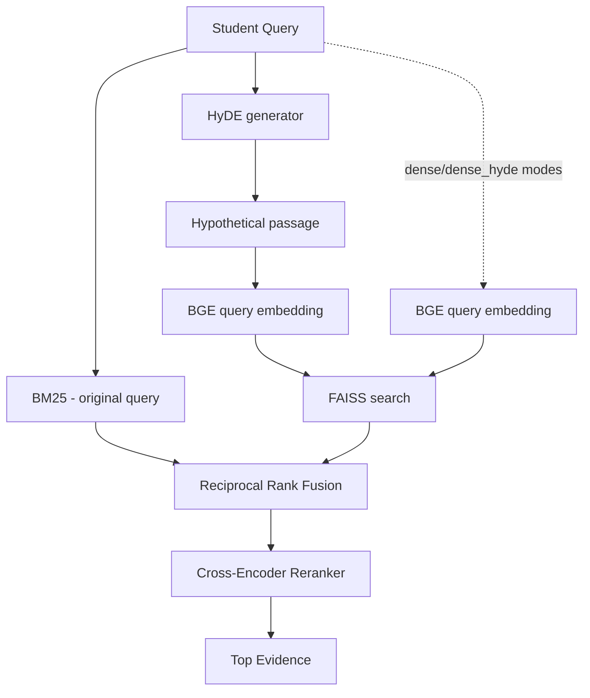

# Retrieval Architecture (Phase 2)

Status: **implemented**. This document describes the retrieval pipeline as
it actually exists in `backend/app/retrieval/`, not a plan — see
[docs/roadmap.md](../roadmap.md) for what is still ahead (Phase 3+:
grounded generation, citations, explainability, study engine).

## Scope Boundary

Phase 2 is **retrieval only**. It does not implement answer generation,
citations, token grounding, contradiction detection, evidence sufficiency,
abstention, the study engine, multimodal VLM retrieval, or Whisper/audio.
The only permitted LLM usage is HyDE query expansion — HyDE only ever
expands the user's own query text, and never receives retrieved document
content (see [docs/research/security.md](../research/security.md)).

## Overview



Every stage is independently callable and independently testable — there
is no single monolithic "retrieve" function. `RetrievalService`
(`app/retrieval/service.py`) only orchestrates already-tested components;
it implements no retrieval algorithm itself.

## 1. Domain Model

`app/retrieval/models.py` — independent of `rank_bm25`/`faiss`/
`sentence-transformers`, the same separation `app.ingestion.models` keeps
from Docling (ADR-004):

- `RetrievalCandidate`: one retriever's view of one chunk (rank + native score).
- `RetrievalResult`: a result returned to a caller. Carries multiple named
  scores (`bm25_rank`/`bm25_score`, `dense_rank`/`dense_score`,
  `rrf_score`, `rerank_score`) rather than one ambiguous `score` field, so
  a hybrid/RRF/reranked result preserves how every stage it passed through
  ranked it.
- `RetrievalTrace`: full observability record for one query — per-source
  candidates, HyDE text/model/params, and a `TimingBreakdown` (query
  embedding, BM25, FAISS, HyDE, RRF, reranking, total, each in ms).
  Available programmatically (not just log lines) — the evaluation runner
  reads it directly.
- `RetrievalMode` (`StrEnum`): `bm25`, `dense`, `dense_hyde`, `hybrid_rrf`,
  `hybrid_rrf_hyde`, `full_baseline`.
- `RetrievalSource` (`StrEnum`): `bm25`, `dense`, `hybrid`, `rrf`, `reranker`.

`app/retrieval/interfaces.py` defines the library-agnostic ABCs
(`Retriever`, `FusionStrategy`, `QueryExpander`, `Reranker`) plus the
fusion/rerank/expansion-specific dataclasses (`FusedCandidate`,
`RerankedCandidate`, `ExpansionResult`). Downstream code (the API layer,
`RetrievalService`, the evaluation runner) depends only on these — never on
`rank_bm25.BM25Okapi`, `faiss.Index`, or `sentence_transformers.*` directly.

## 2. Document Filtering

`app/retrieval/corpus.py::eligible_chunks` is the single filter both BM25
and FAISS indexing apply: `BlockType.IMAGE` chunks are excluded (Phase 1
produces no textual representation of image content yet — no VLM
captioning), everything else is indexed if and only if `content` is
non-empty after stripping whitespace. Table chunks are indexed (Phase 1
chunking always populates a pipe/semicolon text rendering of table cells).
Nothing is deleted from SQLite — this only filters what gets indexed.

## 3. BM25 (Lexical Retrieval)

`app/retrieval/bm25_retriever.py::BM25Retriever`, backed by `rank-bm25`
(`BM25Okapi`) — an established library, not a from-scratch implementation.

- **Tokenization** (`app/retrieval/tokenizer.py`): lowercase + split on
  runs of non-alphanumeric characters. **Baseline behavior**: the minimal,
  standard preprocessing most BM25 implementations assume.
  **Implementation choices**, each made explicitly rather than by default:
  no stopword removal, no stemming/lemmatization — "avoid excessive
  preprocessing without evidence" (spec). The same function tokenizes both
  index-build and query time, so they can never drift apart.
- BM25 always scores the **original user query**. It has no notion of HyDE
  at all — routing which string it receives is `RetrievalService`'s job,
  not `BM25Retriever`'s.
- Deterministic: chunks are indexed in the order `ChunkRepository.list_all()`
  returns (document id, then position); duplicate chunk ids are indexed at
  most once; ties in score are broken by `(-score, chunk_id)`, so ranking
  never depends on dict/array iteration order.
- Empty/whitespace-only query → `[]` (no arbitrary/undefined ordering).
  `top_k <= 0` → `[]`. No indexed chunks → `NoIndexedChunksError`.

## 4. Dense Retrieval (BGE + FAISS)

### Embeddings

`app/retrieval/embeddings.py`:

- `EmbeddingProvider` (ABC): `embed_documents`, `embed_query`,
  `dimension`, `model_id`, `normalizes_embeddings`.
- `BGEEmbeddingProvider`: wraps `sentence-transformers`, model
  `BAAI/bge-small-en-v1.5`. **Dimension: 384.** **Metric: cosine
  similarity**, implemented as inner product over L2-normalized vectors
  (`normalize_embeddings=True` at encode time). CPU-compatible;
  opportunistically GPU if `sentence-transformers` detects one (not
  required). Batch size configurable
  (`Settings.embedding_batch_size`, default 32). The model is loaded once
  per provider instance (lazily, on first `embed_documents`/`embed_query`
  call) and reused for every subsequent call — never reloaded per request;
  the API layer caches one instance per process (see §8).
- **Model revision**: not pinned to a specific Hugging Face commit hash —
  the published `main` revision of `BAAI/bge-small-en-v1.5` is used as-is.
  See [docs/research/reproducibility.md](../research/reproducibility.md)
  for why an exact pin was not added.

### FAISS Index

`app/retrieval/faiss_index.py::FaissIndexStore`:

- **Index type: `faiss.IndexFlatIP`** — exact, brute-force inner-product
  search. This is a research project over a small corpus; the spec
  explicitly asks not to prematurely optimize with IVF/HNSW/PQ ANN indexes.
- **Metric: inner product** over L2-normalized vectors = cosine similarity.
- **Dimension**: taken from the embedding provider (384), never hardcoded
  independently — a mismatch is caught rather than silently corrupting
  search.
- **Persistence** (`Settings.index_dir`, default `data/indexes/`, gitignored):
  `faiss.index` (the raw index), `manifest.json` (`IndexManifest`:
  embedding model id, dimension, index type, metric, normalization,
  `chunk_target_tokens`/`chunk_overlap_tokens`, index version, creation
  timestamp, chunk count, and a per-chunk-id content fingerprint —
  SHA-256 of `id + content`), `id_map.json` (FAISS vector position ->
  chunk id).
- **Lifecycle**: `FaissIndexStore.build(...)` (fresh build/rebuild),
  `.load()` (from disk), `.exists()`, `.is_stale(current_chunks)` (compares
  the current eligible-chunk fingerprint set against the manifest's — a
  changed chunk's content, not just a changed id, is detected),
  `.raise_if_stale(...)` (raises `StaleIndexError`). Deterministic
  de-duplication by chunk id, same rule as BM25 — unit-tested.
- Missing index → `IndexNotBuiltError`. Corrupted manifest/id-map JSON →
  `CorruptedManifestError`. Empty eligible-chunk set → `NoIndexedChunksError`.

### Dense Retrieval

`app/retrieval/dense_retriever.py::DenseRetriever` adapts
`FaissIndexStore` + `EmbeddingProvider` behind the `Retriever` interface.
`retrieve(query, top_k)` embeds whatever string it is given — it has no
opinion on whether that is the original query or HyDE text (same
structural decoupling as BM25). Runs independently of HyDE:
`RetrievalMode.DENSE` (`dense_original_query`) and `RetrievalMode.DENSE_HYDE`
(`dense_hyde_query`) are both separately selectable and separately
measurable. Empty query → `EmptyQueryError`. `top_k` is clamped to the
index size.

## 5. Hybrid Retrieval (Without RRF)

`app/retrieval/hybrid.py::HybridRetriever.retrieve(...)` runs BM25 and
dense retrieval and returns both raw candidate lists **and** the RRF-fused
list, so overlap/differences between the two retrievers are directly
observable. `inspect_union(...)` is a separate, explicitly labeled
**engineering inspection mode** — a simple order-preserving union/dedup of
the two raw candidate sets, in encounter order (BM25 first). It is *not* a
scientifically meaningful weighted-score final ranking; nothing in
`RetrievalService` uses it as an actual retrieval mode. Use `RRFFusion` for
any result reported as a ranking.

## 6. Reciprocal Rank Fusion

`app/retrieval/rrf.py::RRFFusion`:

```
RRF_score(d) = sum over lists i containing d of 1 / (k + rank_i(d))
```

- **k = 60 by default** (`Settings.rrf_k`) — the standard RRF constant,
  and EduRAG's baseline value. Configurable.
- Operates **purely on ranks**, never on the underlying BM25/dense scores
  (which are not on comparable scales) — "do not invent score
  normalization before RRF" (spec).
- Deduplicates a chunk id appearing in both lists into one fused entry,
  preserving each source's rank *and* score (`FusedCandidate.source_ranks`
  / `.source_scores`) alongside the fused score.
- Deterministic tie-breaking: `(-fused_score, chunk_id)`.
- Unit-tested with a hand-computed example (ranking A: A,B,C; ranking B:
  B,D,A; k=60 → exact expected scores asserted, see
  `tests/retrieval/test_rrf.py`).

## 7. HyDE (Hypothetical Document Embeddings)

Three layers, kept separate so the LLM backend is swappable and nothing
is hardwired:

- **Prompt** (`app/retrieval/prompts.py`): one centralized template. Asks
  for a short (2-4 sentence), factual, textbook-style passage that would
  plausibly *contain* the answer — explicitly **not** a final user-facing
  answer, and the model is never shown or told about retrieved documents.
- **LLM client** (`app/retrieval/llm_client.py`): `LLMClient` ABC +
  `OllamaClient`, targeting a local Ollama server
  (`Settings.ollama_base_url`, default `http://localhost:11434`),
  preferred model `deepseek-r1:1.5b` (`Settings.hyde_model`). This is the
  **only** place HTTP calls to the LLM backend happen.
- **Query expansion** (`app/retrieval/hyde.py::HyDEExpander`, implements
  `QueryExpander`): calls `LLMClient.generate` with the rendered prompt.
  If the backend is unreachable, generation fails, or the response is
  empty, it raises `HyDEUnavailableError` — **never** silently falls back
  to the original query or returns a disguised empty result.

Routing (enforced in `RetrievalService`, not in `HyDEExpander` or
`BM25Retriever`): BM25 always receives the original query. Only the
*dense* retriever ever receives HyDE text, and only in `dense_hyde`,
`hybrid_rrf_hyde`, and `full_baseline` modes. HyDE is disabled by default
(`Settings.hyde_enabled = False`); when disabled, `RetrievalService`
receives no `QueryExpander` and any HyDE-dependent mode raises
`HyDEUnavailableError` immediately, rather than silently downgrading to a
non-HyDE mode.

`RetrievalTrace` records: the original query, the generated HyDE text, the
model id, and generation parameters (`max_tokens`, `temperature`) — never
full retrieved document content.

Unit tests (`tests/retrieval/test_hyde.py`) mock `LLMClient` entirely — no
network, no model download. A real-Ollama test
(`tests/retrieval/test_hyde_integration.py::test_real_ollama_generates_a_hyde_passage`)
is marked `@pytest.mark.requires_ollama`, excluded from the default test
run (see `pyproject.toml`'s `addopts`), and additionally self-skips if
Ollama is not reachable at the configured URL.

## 8. Cross-Encoder Reranking

`app/retrieval/reranker.py::CrossEncoderReranker`, model
`cross-encoder/ms-marco-MiniLM-L-6-v2`. Scores `(query, chunk content)`
pairs via `sentence_transformers.CrossEncoder.predict`, sorts descending,
returns the top-K. Loaded once per instance (lazy, first `rerank()` call),
reused across calls — same lifecycle discipline as `BGEEmbeddingProvider`.
Deterministic tie-breaking: `(-score, chunk_id)`. Empty candidate pool or
`top_k <= 0` → `[]`. Unit tests mock the underlying model (a small
deterministic lexical-overlap fake), so the default suite never downloads
weights.

## 9. Retrieval Modes

Selectable via API request body / `RetrievalService.retrieve(mode=...)` —
never by editing source:

| Mode | Pipeline |
|---|---|
| `bm25` | BM25(original query) → top-K |
| `dense` | BGE(original query) → FAISS → top-K |
| `dense_hyde` | HyDE(query) → BGE(hypothetical) → FAISS → top-K |
| `hybrid_rrf` | BM25(original) + FAISS(original) → RRF → top-K |
| `hybrid_rrf_hyde` | BM25(original) + FAISS(HyDE) → RRF → top-K |
| `full_baseline` | BM25(original) + FAISS(HyDE) → RRF → Cross-Encoder → top-K |

`full_baseline` is the complete reproduced EduRAG pipeline (README §6).

## 10. RetrievalService

`app/retrieval/service.py::RetrievalService.retrieve(query, mode, top_k)`
returns `(list[RetrievalResult], RetrievalTrace)`. It coordinates
`BM25Retriever`, `DenseRetriever`, `HyDEExpander`, `RRFFusion`,
`CrossEncoderReranker` — every mode is a different composition of the same
already-tested components; no retrieval algorithm is re-implemented here.
Builds the full `RetrievalTrace` (per-source candidates, HyDE
provenance, per-stage timings) on every call, whether or not the caller
inspects it.

K values used inside a mode when not overridden by the caller's `top_k`:
`bm25_top_k`, `dense_top_k` (candidates fetched from each retriever before
fusion), `rrf_candidate_k` (how much of the fused list is kept/traced),
`rerank_candidate_k` (how many fused candidates are handed to the
reranker), `final_top_k` (default result-set size). All configurable via
`Settings` — see §12.

## 11. Index Lifecycle in the API Layer

`app/api/retrieval.py::get_dense_retriever` builds the FAISS index on
first use if it does not exist, and rebuilds it if `is_stale(chunks)` is
true relative to the current chunk set — this is index bookkeeping to keep
the research/debug endpoint usable out of the box, not a fallback between
retrieval *modes* (the mode the caller asked for still runs against a
consistent index either way). BM25 is rebuilt fresh on every request
(cheap for a research-corpus-sized index); the embedding provider and
cross-encoder reranker are cached as process-level singletons keyed by
model name, since reloading a `sentence-transformers` model per HTTP
request would be prohibitively slow.

## 12. Configuration

All retrieval parameters live in `Settings`
(`backend/app/core/config.py`) — no scattered magic constants:

| Setting | Default | Provenance |
|---|---|---|
| `embedding_model` | `BAAI/bge-small-en-v1.5` | EduRAG baseline |
| `reranker_model` | `cross-encoder/ms-marco-MiniLM-L-6-v2` | EduRAG baseline |
| `bm25_top_k` | 20 | EduRAG baseline |
| `dense_top_k` | 20 | EduRAG baseline |
| `embedding_batch_size` | 32 | Implementation choice |
| `rrf_k` | 60 | EduRAG baseline (standard RRF constant) |
| `rrf_candidate_k` | 20 | EduRAG baseline (see note below) |
| `rerank_candidate_k` | 20 | EduRAG baseline |
| `final_top_k` | 5 | EduRAG baseline |
| `hyde_enabled` | `false` | Implementation choice — opt-in |
| `hyde_model` | `deepseek-r1:1.5b` | Preferred baseline model (project brief) |
| `ollama_base_url` | `http://localhost:11434` | Implementation choice |
| `hyde_max_tokens` | 256 | Implementation choice |
| `hyde_temperature` | 0.2 | Implementation choice |
| `hyde_timeout_seconds` | 30.0 | Implementation choice |
| `index_dir` | `data/indexes/` | Implementation choice (sibling of `data/raw`, `data/processed`) |

**Note on `rrf_candidate_k` provenance**: the spec figure is "RRF candidate
pool top 20 → reranker top 5"; we did not find a citable EduRAG-paper table
enumerating `bm25_top_k`/`dense_top_k` independently of that pool size, so
those three are recorded here as EduRAG-baseline-derived rather than
independently sourced — see
[docs/research/reproducibility.md](../research/reproducibility.md) for the
full citation caveat.

## 13. Retrieval Trace / Observability

Every `RetrievalService.retrieve()` call returns a `RetrievalTrace`
alongside results — available programmatically (read directly by
`ExperimentRunner`, or serialized in the API's `timing` field), not only as
log lines. It never carries full retrieved chunk text beyond what
`RetrievalResult.content` already exposes to the caller.

## 14. Error Behavior

`app/retrieval/errors.py` — one `RetrievalError` base, specific subclasses
each carrying a safe `message`:

| Condition | Error |
|---|---|
| Empty/whitespace query | `EmptyQueryError` |
| Unrecognized mode string | `InvalidModeError` |
| No chunks to index | `NoIndexedChunksError` |
| FAISS index never built | `IndexNotBuiltError` |
| FAISS index stale vs. current chunks | `StaleIndexError` |
| Corrupted manifest/id-map JSON | `CorruptedManifestError` |
| Embedding model failed to load/run | `EmbeddingModelError` |
| Reranker model failed to load/run | `RerankerModelError` |
| HyDE requested but backend unreachable/failed/empty | `HyDEUnavailableError` |

No retrieval error is silently swallowed into a fallback mode unless the
caller explicitly configured one (there is no such fallback in Phase 2 —
e.g. a `dense_hyde` request with HyDE disabled/unreachable always raises,
it never silently degrades to `dense`). The API layer
(`app/api/retrieval.py`) maps these to HTTP 400 (empty query, invalid
mode), 409 (no indexed chunks), or 503 (model/HyDE unavailable).

## 15. Research/Debug API

`POST /retrieval/search` — see [docs/API.md](../API.md) for the full
request/response contract. Explicitly a research/debug endpoint, not the
final chat/answer API (that is Phase 3+). Response content is truncated to
a preview (never the full chunk text or any file path).

## 16. Tokenization Consistency: Phase 1 Chunking vs. the Real BGE Tokenizer

Phase 1's chunking (`app/ingestion/chunking.py::approx_token_count`) counts
tokens by whitespace-splitting, explicitly documented there as "not the
tokenizer of any specific embedding model." Phase 2 measured this against
the real BGE tokenizer (`transformers.AutoTokenizer.from_pretrained(
"BAAI/bge-small-en-v1.5")`):

- **On the actual Phase 1 fixture chunks** (`study_notes.html/docx/pptx`,
  20 non-empty chunks across all three): the real BGE subword-token count
  is **1.25x–2.67x** the whitespace count, mean ratio **≈1.80x**. These
  chunks are all short (single paragraphs/headings/table renderings), so
  none come close to truncation in absolute terms.
- **At the `chunk_target_tokens` boundary** (a synthetic ~512-whitespace-word
  chunk built from representative study-notes-style prose): the real BGE
  tokenizer produced **712 subword tokens** — **39% over** BGE's 512-token
  practical input limit, and `transformers` itself warns
  ("Token indices sequence length is longer than the specified maximum
  sequence length for this model (712 > 512)").

**Finding**: for chunks that actually reach Phase 1's ~512-word target
size, there is a real, non-hypothetical truncation risk when they are
embedded by BGE — `sentence-transformers` truncates silently (no runtime
warning during `.encode()`, only during raw tokenizer calls) to the
model's max sequence length, so up to roughly the last third of a
full-sized chunk's text does not reach the embedding at all. This affects
**dense retrieval only** — BM25 tokenizes and indexes the full chunk text
regardless of length, so lexical retrieval over long chunks is unaffected.

**Disposition (per the Phase 2 spec's instruction to stop-and-report rather
than silently patch Phase 1)**: this is a real quality issue for dense
retrieval over long chunks, but it does not make retrieval non-functional
— BM25 still indexes full chunk content, RRF still fuses both signals, and
only the dense contribution for the (silently truncated) tail of long
chunks degrades. It is not severe enough to justify an unplanned,
under-scoped change to Phase 1 chunking under this ticket. **Phase 1
chunking was left unchanged.** Recommended follow-up (not done here,
tracked as a known limitation): either (a) re-tokenize with BGE's own
tokenizer during chunking instead of whitespace-splitting so
`chunk_target_tokens` means what it says for the model actually consuming
it, or (b) keep whitespace-based chunking for ingestion simplicity but
apply a smaller target (e.g. ~350 whitespace words, extrapolating from the
measured ≈1.4x ratio at this length) specifically when producing chunks
that will be embedded.

## 17. Implementation Choices vs. EduRAG Baseline (Summary)

**From the baseline, reproduced as specified:**
- BM25 (lexical) + FAISS (dense, `bge-small-en-v1.5`) + RRF (k=60) +
  cross-encoder reranker (`ms-marco-MiniLM-L-6-v2`) architecture.
- BM25 always scores the original query; HyDE only ever feeds dense search.
- RRF candidate pool → reranker top-20 → final top-5 (see §12's provenance
  note on `bm25_top_k`/`dense_top_k`/`rrf_candidate_k`).
- Preferred local HyDE model: DeepSeek-R1 1.5B via Ollama.

**Our own implementation choices, documented individually (not silently
invented and attributed to EduRAG):**
- BM25 tokenization: lowercase + alphanumeric splitting, no stopwords, no
  stemming.
- No embedding-model revision pin (see §4, reproducibility.md).
- `IndexFlatIP` exact search rather than any ANN index.
- FAISS index/manifest persistence layout and staleness-by-content-hash
  detection.
- HyDE disabled by default; opt-in via `Settings.hyde_enabled`.
- HyDE prompt template wording (Gao et al.-style "write a passage that
  would answer this" framing).
- `embedding_batch_size`, `hyde_max_tokens`, `hyde_temperature`,
  `hyde_timeout_seconds`, `index_dir` — none specified by EduRAG.
- BM25 rebuilt fresh per API request rather than cached (simplicity over
  latency for a research/debug endpoint); embedding provider and reranker
  cached as singletons (necessary — reloading either per request would be
  prohibitively slow).
- Auto-build/rebuild-on-staleness for the FAISS index in the API layer's
  dependency wiring, as a convenience for the debug endpoint.
