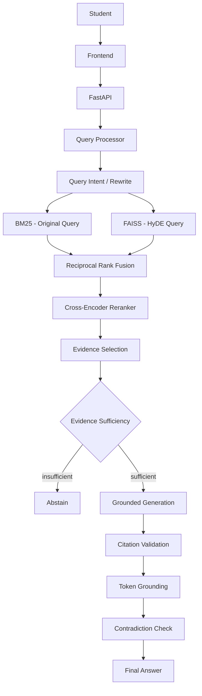
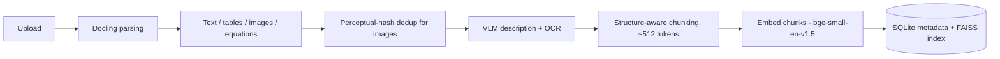
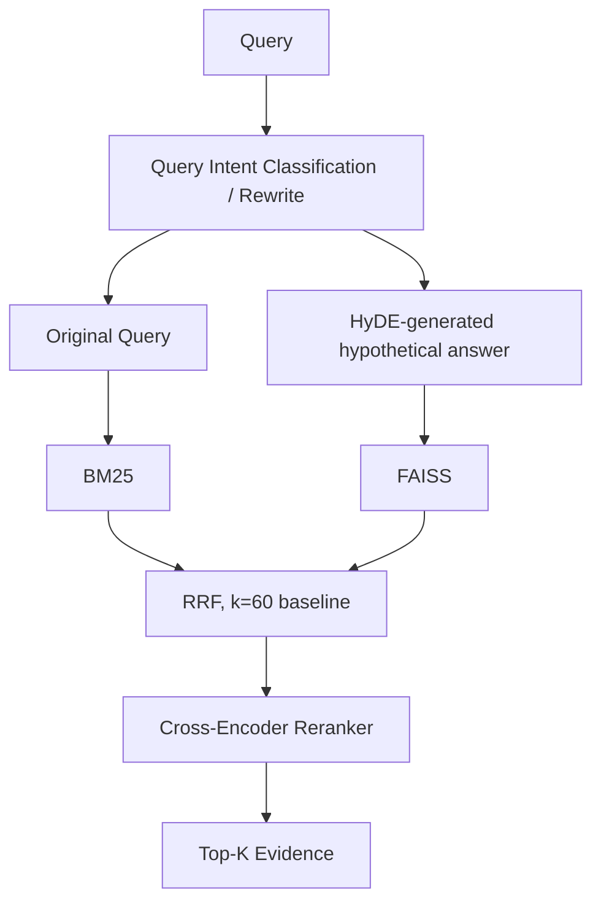
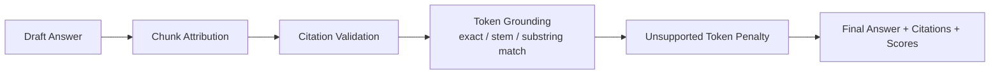
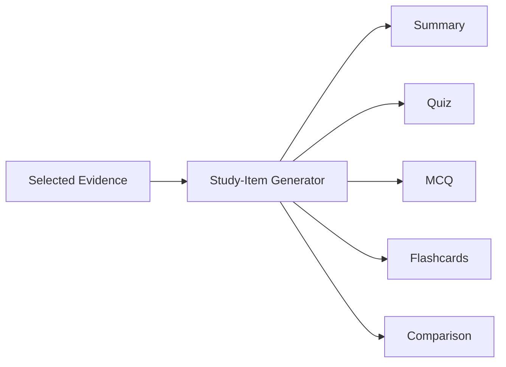
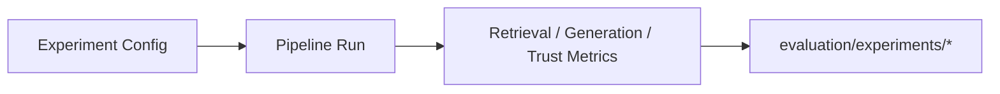

# System Architecture

Status: **design document**. Only the pieces explicitly marked "implemented"
exist in code today (Phase 0: FastAPI app skeleton + `/health`). Everything
else describes the intended architecture that will be built phase-by-phase
per [docs/roadmap.md](../roadmap.md).

## 1. High-Level Architecture

Evidence sufficiency, abstention, and contradiction checking are **proposed
extensions** (see README §7), not part of the reproduced EduRAG baseline —
they are included in this diagram because they sit in the request path once
built, but the baseline pipeline (README §6) stops at reranking → generation
→ explainability.

## 2. Ingestion Pipeline

Each chunk retains provenance: source document, page/section/slide,
chunk type (text/table/image/equation), and — for visual chunks — the
original image path alongside its OCR text and VLM description (not a
caption-only representation).

## 3. Retrieval Pipeline

## 4. Generation Pipeline

Prompt construction treats retrieved chunk text strictly as **data**, never
as instructions — see [docs/research/security.md](../research/security.md).

## 5. Explainability Pipeline

## 6. Study Engine

Every generated study item stores its `source_chunk_ids` so it remains
traceable back to evidence (see [docs/architecture/database.md](database.md)).

## 7. Evaluation Architecture

See [docs/research/evaluation-plan.md](../research/evaluation-plan.md) and
[docs/research/ablation-plan.md](../research/ablation-plan.md) for the
metrics and ablation matrix. Experiment configs and results are never
fabricated — reports only exist once a run has actually happened.
