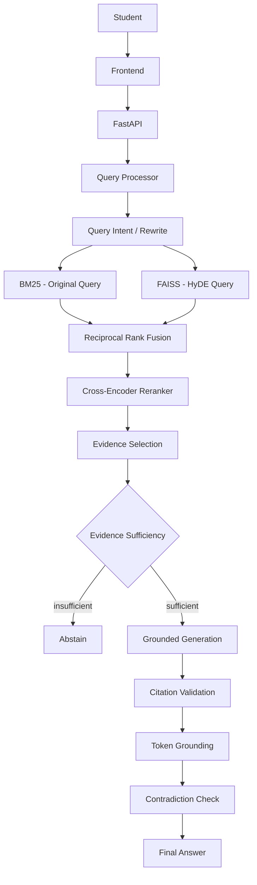
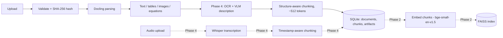
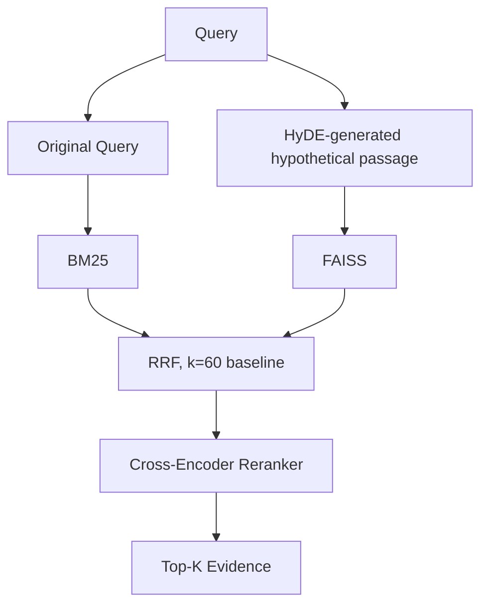
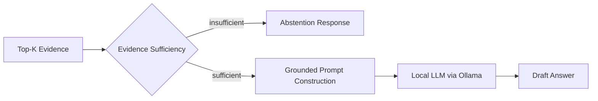
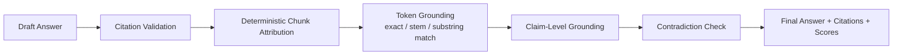
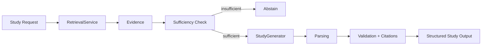
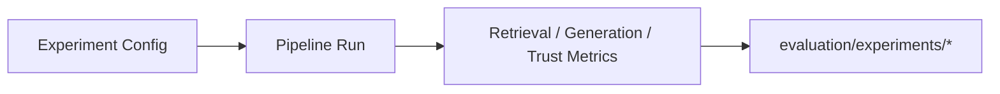

# System Architecture

Status: this document was written in Phase 0 as a **design document**, when
only `/health` existed, and each section below still carries its own
per-phase "Status: implemented for Phase N" note documenting when that
piece was actually built. As of Phase 9 (final), Phases 0–8 are all
complete and merged into `develop` — see
[docs/final/SYSTEM_ARCHITECTURE.md](../final/SYSTEM_ARCHITECTURE.md) for
the consolidated, final, "as implemented" version of this document, with
per-phase detail still cross-referenced to `ingestion.md`, `retrieval.md`,
`generation.md`, `multimodal.md`, and `study-engine.md` as before.

## 1. High-Level Architecture

Evidence sufficiency, abstention, and contradiction checking are **our own
additions on top of the reproduced EduRAG baseline** (see README §7), now
**implemented as of Phase 3** — see
[docs/architecture/generation.md](generation.md). The baseline pipeline
itself (README §6) stops at reranking → generation → explainability; these
three sit in the request path around that baseline, not inside it.

## 2. Ingestion Pipeline

Status: **implemented for Phase 1** through structure-aware chunking and
SQLite persistence — see [docs/architecture/ingestion.md](ingestion.md)
for the actual pipeline, canonical model, and documented limitations.
Embedding and FAISS indexing (below) are **implemented for Phase 2** — see
[docs/architecture/retrieval.md](retrieval.md). VLM/OCR image enrichment,
table/equation representation helpers, and audio/Whisper ingestion are
**implemented for Phase 4** — see
[docs/architecture/multimodal.md](multimodal.md). Perceptual-hash image
dedup remains unimplemented (not part of the Phase 4 brief).

Each chunk retains provenance: source document, page/section, chunk type
(heading/paragraph/list/table/image/equation/code/caption/transcript),
and — for image chunks — the extracted image path (where Docling provides
the bytes; see ingestion.md for the HTML exception) plus, as of Phase 4,
OCR text/VLM description/vision status and a link to the `artifacts` table
recording the original artifact. Perceptual-hash image dedup remains
unimplemented.

## 3. Retrieval Pipeline

Status: **implemented for Phase 2** — see
[docs/architecture/retrieval.md](retrieval.md) for the full design
(domain model, BM25/dense/hybrid/RRF/HyDE/reranking architecture, index
lifecycle, retrieval modes, trace/observability, error behavior, and the
explicit EduRAG-baseline-vs-implementation-choice list). Query intent
classification/rewrite (beyond HyDE) is not part of Phase 2 — the diagram
below is the Phase 2 `full_baseline` mode; `dense`/`hybrid_rrf`/etc. are
separately selectable subsets of this same pipeline, not implemented as
new diagrams here.

As of Phase 4, chunks eligible for BM25/FAISS indexing include enriched
image chunks (VLM description + OCR + surrounding text) and audio
transcript chunks alongside text/table chunks — no new retrieval mode or
index was added; the existing pipeline above now simply has more, and more
varied, content indexed underneath it. See
[docs/architecture/multimodal.md](multimodal.md) "Retrieval Integration".

## 4. Generation Pipeline

Status: **implemented for Phase 3** — see
[docs/architecture/generation.md](generation.md) for the full design
(evidence sufficiency, prompt construction, the `Generator`/`OllamaGenerator`
abstraction, failure modes, and the EduRAG-baseline-vs-implementation-choice
list, following the same documentation discipline as retrieval.md).

Prompt construction treats retrieved chunk text strictly as **data**, never
as instructions — see [docs/research/security.md](../research/security.md).

## 5. Explainability Pipeline

Status: **implemented for Phase 3**, delivered together with generation
(above) rather than as a separate later phase — see
[docs/roadmap.md](../roadmap.md)'s Phase 3 scope note and
[docs/architecture/generation.md](generation.md).

## 6. Study Engine

`StudyEngineService` (`app.study.service`) orchestrates six modes —
summary, explain, compare, quiz, mcq, flashcards — entirely on top of the
existing Phase 2 `RetrievalService` and Phase 3 `HeuristicSufficiencyChecker`
/ `DeterministicCitationValidator` / `LexicalContradictionChecker`; it does
not retrieve or ground anything itself. See
[docs/architecture/study-engine.md](study-engine.md) for the full design.
Every generated study item stores its `source_chunk_ids` so it remains
traceable back to evidence (see [docs/architecture/database.md](database.md)).

## 7. Evaluation Architecture

See [docs/research/evaluation-plan.md](../research/evaluation-plan.md) and
[docs/research/ablation-plan.md](../research/ablation-plan.md) for the
metrics and ablation matrix. Experiment configs and results are never
fabricated — reports only exist once a run has actually happened.
