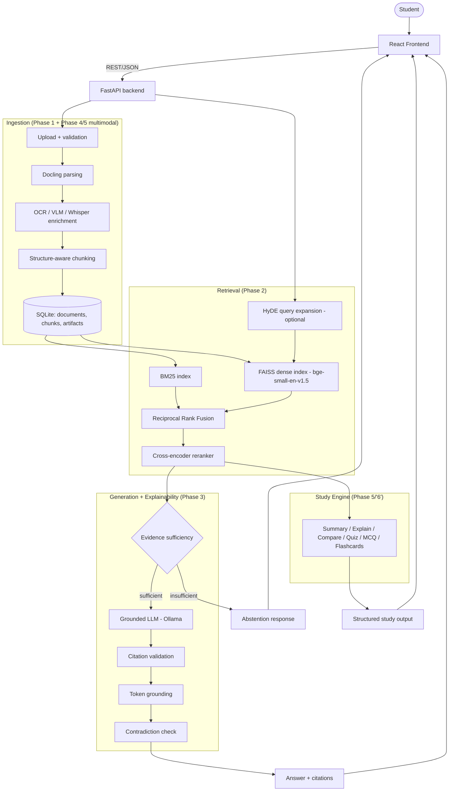

# Final System Architecture (Phase 9)

This document describes the system **as implemented** on `develop` @
`5c58f41` (Phase 0–8 complete). It supersedes the "design document" framing
of `docs/architecture/system-architecture.md` (written in Phase 0, before
anything beyond `/health` existed) as the single accurate top-level
architecture reference; the per-phase documents it links to
(`ingestion.md`, `retrieval.md`, `generation.md`, `multimodal.md`,
`study-engine.md`, `database.md`, `frontend.md`) remain the authoritative
detail for each subsystem and are cross-referenced below rather than
duplicated.

## 1. High-Level Request Flow

This diagram matches the implemented module layout under `backend/app/`:
`ingestion/`, `retrieval/`, `generation/`, `multimodal/`, `study/`,
`explainability/`, `api/`, `core/`, `benchmarking/`. It does not add,
remove, or rename any pipeline stage relative to the per-phase docs — it
is a consolidated view of Phases 1–5 as they exist together today.

## 2. Backend Module Map (verified against `backend/app/`)

| Module | Responsibility | Phase |
|---|---|---|
| `app.core` | Settings, DB connection, shared config (incl. `security_*` limits) | 0 / 8 |
| `app.ingestion` | Upload, validation, Docling parsing, chunking, storage, hashing | 1 |
| `app.ingestion.parsers` | Format-specific parsing (PDF/DOCX/PPTX/HTML) | 1 |
| `app.multimodal` | Image/OCR/VLM enrichment, audio ingestion, security guards | 4/5 |
| `app.retrieval` | BM25, dense (FAISS), RRF fusion, HyDE, cross-encoder reranker, `RetrievalService` | 2 |
| `app.retrieval.evaluation` | Retrieval metrics (`metrics.py`) reused by benchmarking | 2/7 |
| `app.generation` | `GenerationService`, prompts, sufficiency, `Generator`/`OllamaGenerator`, `prompt_security`, `injection_detection` | 3 / 8 |
| `app.explainability` | Citation validation, attribution, token grounding, contradiction checking | 3 |
| `app.study` | `StudyEngineService`, mode-specific prompts/parsing/validation/dedup | 5 |
| `app.benchmarking` | Phase 7 evaluation configurations, metrics extensions | 7 |
| `app.schemas` | Pydantic request/response models for every router | all |
| `app.services` | Cross-cutting service wiring / dependency providers | all |
| `app.models` | Domain models (`Chunk`, `Document`, `Artifact`, study item types) | all |
| `app.api` | FastAPI routers: `documents`, `chunks`, `artifacts`, `retrieval`, `chat`, `study`, `health` | all |

## 3. Data Model (see `docs/architecture/database.md` for full schema)

Core tables: `documents`, `chunks`, `artifacts`, `study_items`. Every
chunk retains provenance (`document_id`, `page`/`section`, `chunk_type`)
and, for multimodal chunks, `ocr_text`/`vlm_description`/`vision_status`/
`artifact_id`/`audio_start`/`audio_end`. Deletes cascade transactionally
(`DocumentRepository.delete`) so removing a document removes its chunks,
artifacts, and study items — verified live in Phase 9 (`DELETE
/documents/{id}` → `204`, subsequent `GET` → `404`).

## 4. Retrieval Pipeline Detail

See `docs/architecture/retrieval.md`. Six selectable modes:
`bm25`, `dense`, `dense_hyde`, `hybrid_rrf`, `hybrid_rrf_hyde`,
`full_baseline`. RRF fusion uses `k=60`. Reranking uses
`cross-encoder/ms-marco-MiniLM-L-6-v2`. HyDE uses a small local LLM
(`deepseek-r1:1.5b` by default) via Ollama and is skipped/fails cleanly
(`503`) when Ollama is unavailable — verified live in this environment.

## 5. Generation + Explainability Pipeline Detail

See `docs/architecture/generation.md`. Evidence sufficiency is a
heuristic check (`HeuristicSufficiencyChecker`) run before any LLM call;
insufficient evidence short-circuits to a fixed abstention response with
no model call. Citation validation
(`DeterministicCitationValidator`) accepts only chunk ids that are
actually present in the current request's retrieved evidence — backend-
controlled, never trusted from model output. Token grounding matches
answer tokens back to evidence text (exact/stem/substring). Contradiction
checking (`LexicalContradictionChecker`) flags disagreement across
evidence chunks.

## 6. Study Engine Detail

See `docs/architecture/study-engine.md`. `StudyEngineService` orchestrates
six modes (Summary, Explain, Compare, Quiz, MCQ, Flashcards) entirely on
top of the existing `RetrievalService` and Phase 3
sufficiency/citation/contradiction components — it does not retrieve or
ground anything independently. Every generated study item stores
`source_chunk_ids` for traceability.

## 7. Multimodal Processing Detail

See `docs/architecture/multimodal.md`. Images/diagrams get OCR text +
VLM description merged into searchable chunk content while the original
image bytes are always preserved (`artifacts` table, `image_path`); audio
produces timestamped transcript chunks via Whisper (faster-whisper).
Docling's `PICTURE` label does not distinguish photos from diagrams, so
both share `BlockType.IMAGE` — a documented parser limitation, not a
missing feature. No direct visual (CLIP-style) embedding retrieval is
implemented — image chunks are retrieved via their text representation
only.

## 8. Security Architecture

See `docs/security/THREAT_MODEL.md`, `SECURITY_AUDIT.md`,
`SECURITY_CONFIGURATION.md`. Key controls implemented as of Phase 8:
magic-byte upload validation, centralized resource ceilings
(`Settings.security_*`), evidence-is-data prompt framing plus structural
marker-neutralization against indirect prompt injection, log-only
injection-signal detection, deterministic backend-controlled citation
validation, parameterized SQL throughout, cascade-safe deletes, temp-file
cleanup on every ingestion failure path, and security response headers.
No authentication/authorization exists — by design, for a local-first,
single-user scope (see `THREAT_MODEL.md` Non-Goals).

## 9. Evaluation Architecture

See `docs/research/evaluation-plan.md`, `docs/research/ablation-plan.md`,
and `docs/evaluation/PHASE_7_EVALUATION_REPORT.md`. Retrieval metrics
(`app.benchmarking.metrics_ext` on top of `app.retrieval.evaluation.metrics`)
were measured against a small pilot corpus (`evaluation/datasets/pilot_v1.json`
— 3 documents, 23 chunks, 14 questions). Results live under
`evaluation/results/run_baseline_20260904T032025Z/` and are consolidated
in `docs/final/FINAL_PROJECT_REPORT_CONTENT.md` §"Evaluation Methodology".

## 10. Frontend

React + TypeScript + Vite + Tailwind, `frontend/src/`. Renders all
API-sourced content as plain React text (no `dangerouslySetInnerHTML`,
no markdown-to-HTML, auto-escaped) — see `docs/architecture/frontend.md`
and the Phase 8 frontend security audit (`PHASE_8_SECURITY_REPORT.md` §15).

## 11. What This Diagram Deliberately Does Not Add

Per the Phase 9 brief's absolute rule, this document does not introduce
any new architectural component. It consolidates and re-presents what
Phases 0–8 already built and verifies it against the actual module
layout — it does not propose direct visual embedding retrieval,
authentication, a distributed queue, or any other unimplemented
capability. Those remain explicitly listed as future work in
`docs/final/FINAL_PROJECT_REPORT_CONTENT.md` §"Future Work" and
`docs/final/PHASE_9_FINAL_REPORT.md` §13.
